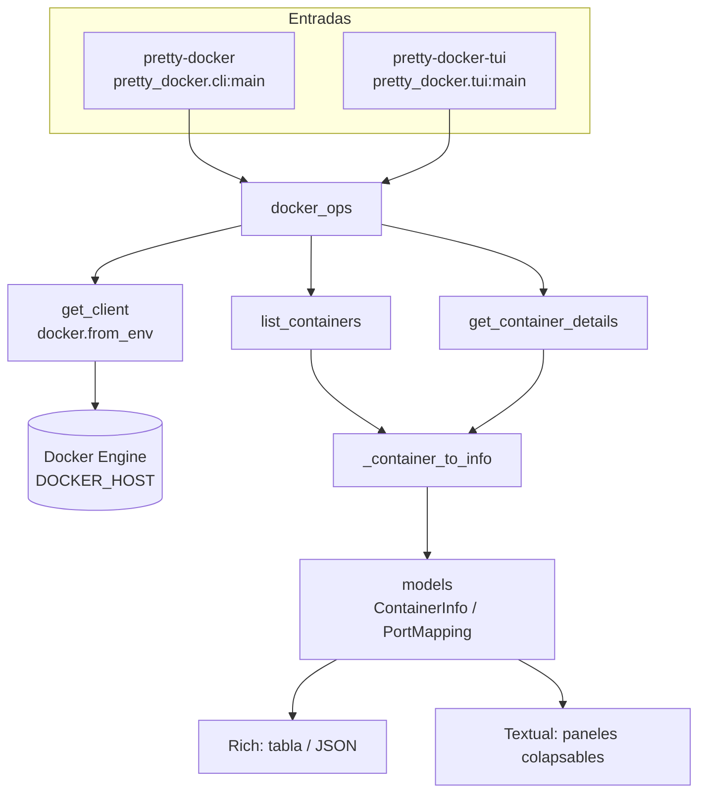

# pretty-docker

Terminal User Interface (TUI) y CLI tool para ver información de contenedores Docker de forma limpia y formateada. Construido con Textual para la TUI y Rich para el CLI, usando el Docker SDK en lugar de shell commands.

[](LICENSE)
[](https://python.org)
[](https://textual.textualize.io/)
[](https://rich.readthedocs.io/)
[](https://docker-py.readthedocs.io/)
[](https://github.com/bi0punk/pretty-docker/actions)

## Contenido

- [Características](#características)
- [Arquitectura](#arquitectura)
- [Stack](#stack)
- [Estructura del repositorio](#estructura-del-repositorio)
- [Instalación](#instalación)
- [Uso](#uso)
- [Configuración](#configuración)
- [Tests / CI](#tests--ci)
- [Roadmap](#roadmap)
- [Licencia](#licencia)

## Características

- **Modo TUI**: app interactiva con paneles colapsables para cada contenedor.
- **Modo CLI**: salida formateada en tabla o JSON para scripting.
- **Docker SDK nativo**: sin dependencia del CLI `docker`.
- **Async Workers**: UI no bloqueante con Textual 8.x.
- **Formateo de puertos**: muestra correctamente host:container en lugar de repr Python.
- **Filtro por estado**: muestra solo contenedores running con `--running`.
- **Atajos de teclado**: expandir/colapsar, refresh, quit.

## Arquitectura



## Stack

| Componente | Tecnología |
|---|---|
| Lenguaje | Python 3.10+ |
| TUI Framework | Textual >= 8.0 |
| CLI Formatting | Rich >= 13.0 |
| Docker Integration | Docker SDK >= 7.0 |
| Testing | pytest |

## Estructura del repositorio

```
pretty-docker/
├── pretty_docker/
│   ├── __init__.py
│   ├── cli.py               # CLI mode (Rich tables / JSON)
│   ├── tui.py               # TUI mode (Textual interactive)
│   ├── docker_ops.py        # Docker SDK wrapper
│   └── models.py            # ContainerInfo, PortMapping
├── tests/
│   ├── __init__.py
│   └── test_docker_ops.py   # Tests con mocks
├── .github/workflows/ci.yml
├── pyproject.toml
├── LICENSE
└── README.md
```

## Instalación

Requisitos: Python 3.10+, Docker Engine en ejecución y Docker SDK para Python.

### Desde fuente

```bash
git clone https://github.com/bi0punk/pretty-docker.git
cd pretty-docker
pip install -e .
```

### Usando pip (cuando esté publicado)

```bash
pip install pretty-docker
```

### Usando uv

```bash
uv pip install -e .
```

## Uso

### TUI mode

```bash
pretty-docker-tui
```

Atajos de teclado:

| Tecla | Acción |
|---|---|
| `c` | Collapse all |
| `e` | Expand all |
| `r` | Refresh |
| `q` | Quit |

Cada contenedor aparece como panel colapsable. Presiona **Enter** o haz clic para expandir.

### CLI mode

```bash
# Table format (default)
pretty-docker

# Running containers only
pretty-docker --running

# JSON output (for scripting)
pretty-docker --json

# Combine flags
pretty-docker --running --json
```

Ejemplo de salida CLI:

```
┌───────────────┬─────────┬────────────────┬──────────────────┐
│ Name          │ State   │ Image          │ Ports            │
├───────────────┼─────────┼────────────────┼──────────────────┤
│ my_app        │ running │ nginx:latest   │ 0.0.0.0:8080 -> 80/tcp │
│ redis_cache   │ running │ redis:7-alpine │ 0.0.0.0:6379 -> 6379/tcp │
│ old_worker    │ exited  │ python:3.12    │ No ports exposed │
└───────────────┴─────────┴────────────────┴──────────────────┘
```

### Entry points

| Comando | Módulo | Descripción |
|---|---|---|
| `pretty-docker` | `pretty_docker.cli:main` | CLI mode |
| `pretty-docker-tui` | `pretty_docker.tui:main` | TUI mode |

## Configuración

Variables de entorno (ver `.env.example`):

| Variable | Default | Descripción |
|---|---|---|
| `DOCKER_HOST` | `unix:///var/run/docker.sock` | Socket Docker |

## Tests / CI

```bash
pip install pytest
pytest
```

El workflow `.github/workflows/ci.yml` ejecuta lint (Ruff) y tests (pytest) en cada push/PR.

## Roadmap

- [x] TUI interactiva con paneles colapsables
- [x] CLI con tabla y JSON
- [x] Docker SDK nativo
- [ ] Filtros por nombre/imagen
- [ ] Acciones desde TUI (start, stop, restart)
- [ ] Logs en vivo de contenedores
- [ ] Estadísticas de recursos (CPU, RAM)
- [ ] Modo vigilancia (auto-refresh periódico)
- [ ] Soporte Docker Swarm / Kubernetes

## Licencia

MIT
